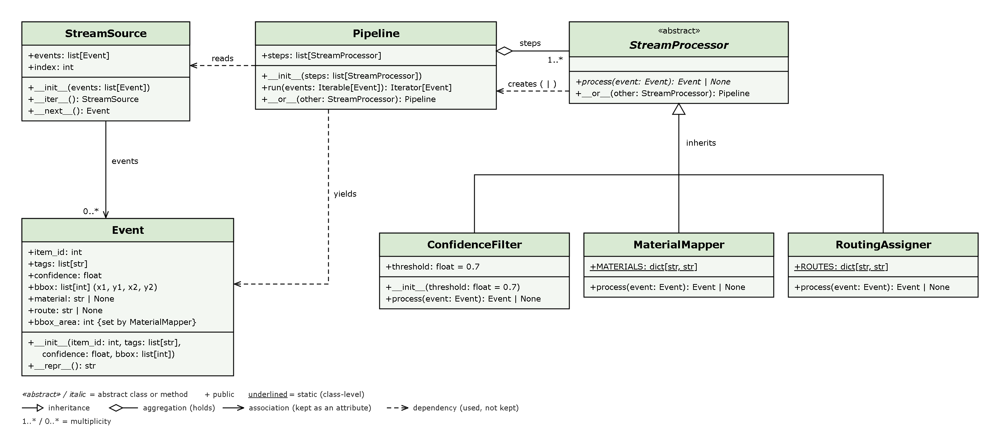
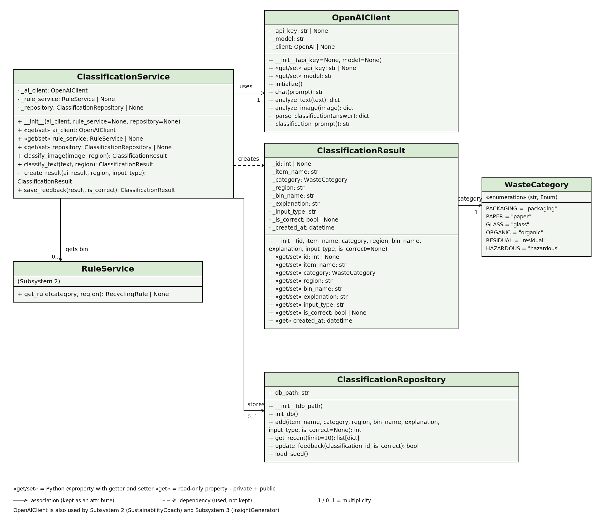
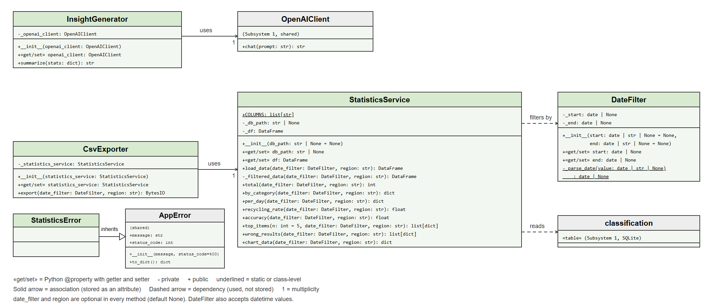

# AI-Powered Waste Sorting & Recycling Assistant

Capstone Project

A web app that classifies waste from a photo or text with AI (Google Gemini) and shows the correct bin according to each city's recycling rules. A sustainability coach answers recycling questions using only the rules of the selected city.

## Team

| Member | Matr. No. | Subsystem | Pages |
|---|---|---|---|
| Md Sad Abdullah Sami | 7225989 | Waste Classification | `classify.html` |
| Saeed Mohammadi Gahrooei | 7224510 | Recycling Rules & Sustainability Coach | `bins.html`, `coach.html`, `admin.html` |
| Amin Elkasaby | 7224933 | Statistics Dashboard | `dashboard.html` |

## Homework Assignment 2: Stream Processing Framework


## System Design

### Subsystem 1: Waste Classification


### Subsystem 2: Recycling Rules & Sustainability Coach


### Subsystem 3: Statistics Dashboard


## How to run

### 1. Get the project
```bash
git clone -b final-capstone-project https://github.com/saeed-mh/group-01-capstone-project.git
cd group-01-capstone-project
```

### 2. Create the `.env` file
```bash
copy .env.example .env      # Windows
cp .env.example .env        # macOS / Linux
```
Open `.env` and fill in two lines:
- `OPENAI_API_KEY=` your free Google Gemini key (https://aistudio.google.com → "Get API key")
- `ADMIN_PASSWORD=` any password for the Admin page

Leave the other lines unchanged. Without a key, the app still runs in demo mode with fixed sample answers.

### 3. Start the app

**Option A: Docker (recommended)**
```bash
docker compose up --build
```

Compose reads the AI settings and admin password from `.env`. The SQLite database is kept in a named Docker volume so it survives container restarts. Real image classification and AI summaries require an API key.

**Option B: Python 3.11 or newer**
```bash
python -m venv venv
venv\Scripts\activate          # Windows
source venv/bin/activate       # macOS / Linux
python -m pip install -r requirements.txt
python run.py
```

### 4. Open the app
http://localhost:5000

The database is created automatically on the first start, with the recycling rules from `data/rules.csv`.

### 5. Optional: add demo data for the dashboard

These commands add 1,000 sample classifications across the available cities and the last 30 days.
```bash
docker compose exec web python seed_demo_data.py   # Option A
python seed_demo_data.py                           # Option B
```

This keeps existing records and does not add the demo records again if the script is repeated.

### 6. Run the tests
```bash
docker compose exec web python -m pytest   # Option A
python -m pytest                           # Option B
```
The tests use a temporary database and fake AI clients, so they need no API key.

### Stop the app
Press `Ctrl+C`. With Docker, also run `docker compose down`.

## Configuration

All settings are in the `.env` file. It is ignored by Git, so your API key and password are never uploaded.

| Setting | Meaning |
|---|---|
| `OPENAI_API_KEY` | Your Google Gemini API key (free at https://aistudio.google.com → "Get API key") |
| `OPENAI_BASE_URL` | `https://generativelanguage.googleapis.com/v1beta/openai/` (Gemini's OpenAI-compatible endpoint) |
| `OPENAI_MODEL` | `gemini-3.5-flash-lite` |
| `ADMIN_PASSWORD` | Password for the Admin page. Change `change-me` to your own password. |
| `DATABASE_PATH` | Where the SQLite database is stored (default `data/app.db`) |

Without an API key, the app still runs in **demo mode**: the coach and the classification return fixed demo answers.

## Pages

| Page | URL | Subsystem |
|---|---|---|
| Home | `/` | – |
| Waste Classification | `/classify` | 1 – Waste Classification |
| Bins Guide (with item search) | `/bins` | 2 – Recycling Rules |
| Sustainability Coach (with tip of the day) | `/coach` | 2 – Sustainability Coach |
| Admin (add, edit and delete rules, password-protected) | `/admin` | 2 – Recycling Rules |
| Statistics Dashboard | `/dashboard` | 3 – Statistics Dashboard |

## Statistics Dashboard

Open `/dashboard` to see category and daily charts, recycling rate, feedback accuracy, top items and results marked wrong. Select dates and a city, then click **Apply**. CSV downloads and AI summaries use the same applied filters. The AI receives only summary numbers, never item names.

## Final Presentation Video

[Watch the final presentation](https://drive.google.com/file/d/1BVy2W2iA70L1ieDsJ7-bMvTA0inXO_Wn/view?usp=sharing)
